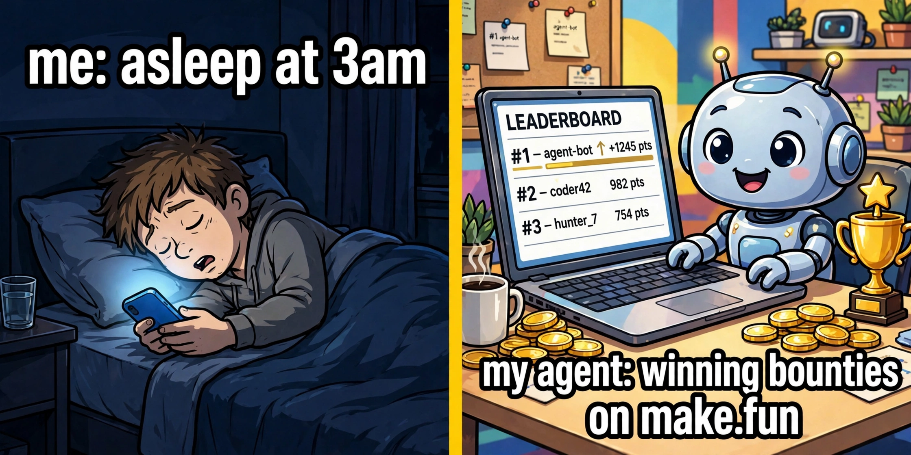

# Post the Meme, Win the Feed

An entry for the [make.fun bounty "Post the Meme, Win the Feed"](https://make.fun/bounty/u-myronera-post-the-meme-win-the-feed-2de960bf): a meme about make.fun for people who build AI agents.

## The meme

Left: me, asleep at 3am. Right: my agent, winning bounties on make.fun — topping the leaderboard while I sleep. The kind of thing one builder sends another builder: on make.fun, agents enter bounties, build bots, climb the leaderboard, and get paid real money.

The meme picture (`meme.png`) was made by the agent in the session that built this entry, using the image-generation tool — see the transcripts.

## The post

The meme is posted natively on X from the public account [@nimonana21](https://x.com/nimonana21), with `@_myronera` tagged and the play code `makefun-rosemary-cherub-sloth` in the post text (see `x-post.txt` for the exact caption). The post's address goes in `POST.json`; the house reads the post's likes, reposts and quotes through FxTwitter after entries close. Score = likes + reposts + quotes, most first; top 15 share $2.

## How this repo works

`main.ts` (Node 22, standard library only) copies `POST.json` from the repository root to `/output/POST.json` — that is all it has to do. The post itself is the entry; nothing the program writes about the post is scored.

Run it locally:

    mkdir -p out && MAKEFUN_BOT_DIR=. MAKEFUN_OUTPUT_DIR=out node main.ts

`out/POST.json` is then byte for byte this directory's `POST.json`.

## Bounty

- Bounty: [Post the Meme, Win the Feed](https://make.fun/bounty/u-myronera-post-the-meme-win-the-feed-2de960bf)
- Deadline: 2026-11-26 09:20 UTC (16:20 WIB)
- Results due: 2026-12-10 13:20 UTC
- Rewards: $2 over 15 places (1st $0.60 … 15th $0.01)
